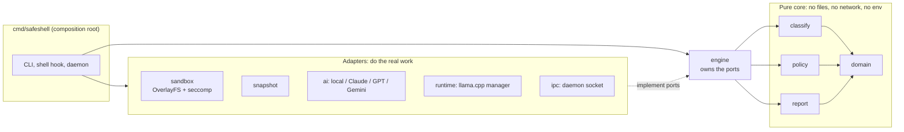
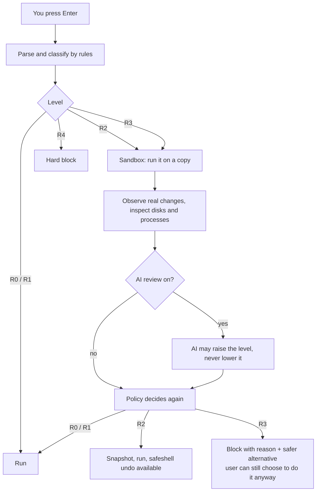
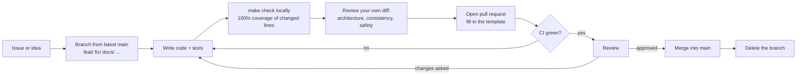

# Contributing to SafeShell

Thank you for helping. This guide explains how the project is organised, how to get your
change merged, and how releases happen. By taking part you agree to follow the
[Code of Conduct](CODE_OF_CONDUCT.md). The code is under the [MIT licence](LICENSE); by
contributing you agree your work is released under it too.

Contents: [Ways to help](#ways-to-help) · [Set up](#set-up-your-machine) · [How the code is organised](#how-the-code-is-organised) · [How a command is judged](#how-a-command-is-judged) · [The pull request workflow](#the-pull-request-workflow) · [Coding rules](#coding-rules) · [Tests](#tests) · [Commits and PRs](#commits-and-pull-requests) · [Releases](#releases) · [Security](#reporting-security-problems)

## Ways to help

| You want to... | Do this |
|---|---|
| Report a bug | Open an issue: what you typed, what you expected, what happened, and the output of `safeshell doctor` and `safeshell version` |
| Say a command is rated wrongly | Open an issue with the command and the level you think it deserves (see below, this is the most useful report there is) |
| Add or fix a classifier rule | Edit `internal/classify/rules/`, add the command to `eval/corpus`, open a PR |
| Improve the AI prompts | Change `internal/nl/translate.go`, run `safeshell ai bench`, put the before/after numbers in the PR |
| Improve docs | Edit any `.md` file and open a PR; no tests needed |

### Issue labels

| Label | Meaning |
|---|---|
| `bug` | something gives a wrong or unsafe result |
| `enhancement` | a new feature or improvement |
| `priority: high` | fix first: a wrong safety rating or data-loss risk |
| `priority: medium` | should be fixed soon |
| `priority: low` | nice to have |
| `good first issue` | small, well explained, no deep knowledge of the sandbox needed: a good place to start |
| `wip` | someone is working on it; comment on the issue before starting so two people don't do the same work |

Small fixes can go straight to a PR. For anything bigger (a new adapter, a new shell, a
change to the safety model), open an issue first so we agree on the approach before you write code.

## Set up your machine

Needs Linux (amd64 or arm64), Go (the version in `go.mod`), `make`, and git.

```bash
git clone https://github.com/samarthsinh2660/safeshell.git
cd safeshell
make build                    # produces bin/safeshell
make check                    # vet + gofmt + race tests + arm64/riscv64 vet; must pass
```

The sandbox tests need user namespaces. On Ubuntu 24.04+ run the one-time rule first
(`scripts/install-apparmor.sh bin/safeshell`, uses sudo), then:

```bash
make integration                                    # real binary, real kernel
SS_SWEEP=1 go test ./test/integration -run Sweep    # every labelled command through the real binary
```

`safeshell doctor` shows what your machine supports. Tests that need a missing feature skip themselves.
CI installs the same rule and runs both with `SS_NEED_SANDBOX=1`, which makes a missing sandbox fail
the tests instead of skipping them, so every pull request is checked with the real sandbox.

## How the code is organised

SafeShell uses a hexagonal layout: pure logic in the middle, side effects at the edges.
Dependencies point inward only.



The rules this picture enforces:

- `domain`, `classify`, `policy`, `report` never touch files, processes, the network or the environment.
- `engine` depends only on small interfaces it defines itself ("ports"). Adapters implement them
  and never import `engine`.
- `cmd/safeshell` is the only place that wires adapters to the engine. It holds no business logic.
- A new shell, snapshot backend, AI provider or inspector is a new adapter or file, not edits scattered through the engine.

More detail in [doc/architecture.md](doc/architecture.md).

## How a command is judged

Every change must keep these safety properties:



Levels: **R0** read-only, **R1** easily reversed, **R2** reversible with a snapshot,
**R3** irreversible, **R4** catastrophic. Evidence order is ESTIMATED < INSPECTED < PREVIEWED < OBSERVED.

Invariants (a PR that breaks one will not be merged):

1. Observed effects and the AI can only **raise** a level, never lower it.
2. Anything unknown, failed or timed out keeps at least its rule level and does not run unattended.
3. The sandbox never modifies real files.
4. If SafeShell itself breaks, the shell hook **fails open with a visible warning**, so your terminal keeps working.

## The pull request workflow

`main` is protected. Nothing is committed to it directly.



Step by step:

```bash
git switch main && git pull --ff-only origin main
git switch -c fix/short-description          # prefixes: feat/ fix/ docs/ chore/ refactor/ test/
# ...work...
make check                                   # add make integration if you touched sandbox/hook/daemon/snapshots
git add -A && git commit -m "fix(classify): rate xargs rm as R3"
git push -u origin fix/short-description     # then open the PR on GitHub
```

Keep one concern per PR. If `main` moved while you worked, `git rebase origin/main`
(not a merge commit) and re-run the checks.

## Coding rules

- Follow standard Go style. `gofmt`, `go vet` and `go test -race` must be clean.
- Write the minimum code that solves the problem. No speculative options, no abstraction for a single use, no dead code.
- Change only what the PR is about. Don't reformat or "improve" neighbouring code; mention unrelated problems in the PR instead.
- Errors: wrap with `%w`, say what the user can do next, never include secrets or quote response bodies.
- User-facing text is plain English: short, no internal jargon, and it says the next step.
- Linux only (amd64 + arm64; riscv64 must vet). CGO stays off. A new dependency needs a reason in the PR.
- Never put API keys, tokens or passwords in code, tests, config, logs or commit messages.

## Tests

- Every behaviour change has a test. A bug fix has a test that **failed before** the fix.
- A pull request covers **100% of the lines it adds or changes**. Codecov checks this on every PR
  (`codecov.yml`). Check locally with `go test -coverprofile=c.out ./...` and `go tool cover -func=c.out`.
  The only exception is code that runs only inside the real sandbox child; say so in the PR.
- Classifier rules use table tests. `eval/corpus` is the development set; `eval/heldout` is an
  independent set that only grows with new, unseen commands. `TestHeldoutReport` enforces
  accuracy floors: fix the rule, never lower a floor.
- AI code is unit-tested with fake backends, never the network. `safeshell ai bench` measures real
  accuracy on 49 fixed requests (local Qwen 3B 49/49; cloud about 95-100%, measured on gemini-flash-lite-latest, so re-run `safeshell ai bench` for the current default).
- Live tests against a provider are opt-in and take keys from environment variables only.

## Commits and pull requests

- Commit messages are short and conventional: `feat(ai): ...`, `fix(sandbox): ...`, `docs: ...`, `chore: ...`, `test: ...`, `refactor: ...`.
- Prefer a few meaningful commits to many tiny ones.
- Fill in the PR template: what and why, how you checked it, anything the reviewer should look at closely.
- Before you open the PR, review your own diff for the architecture rules, consistency with the
  existing code and docs, the safety invariants and the business logic.
- CI shows each part as its own check: format and vet, unit tests and coverage, installer script,
  fuzz, integration with the real sandbox plus the sweep, and package build. `check` passes only when all of them pass.
- Reviewers look for: the safety invariants above, tests, plain-English messages, and a diff that matches the description.

## Releases

Only maintainers release. A release is a pull request from a branch named exactly
`release/vX.Y.Z` into `main`.

```mermaid
flowchart LR
    F[Feature PRs merged to main] --> RB[Create branch release/vX.Y.Z]
    RB --> RP[Release PR: docs, notes, version mentions only]
    RP --> CI{CI green + approved?}
    CI -->|yes| MG[Merge]
    MG --> WF[release.yml runs]
    WF --> T[make check]
    T --> BU[Build tarballs + .debs (amd64, arm64) + SHA256SUMS]
    BU --> GR[GitHub Release created with the files attached]
```

Use semantic versions: patch for fixes, minor for new features, major for breaking changes.
Users then download the `.deb` or tarball from the Releases page. Getting SafeShell into the
official Debian and Ubuntu archives is described in [doc/debian-ubuntu.md](doc/debian-ubuntu.md).
The step-by-step release checklist and the plan for the next versions are in
[doc/releasing.md](doc/releasing.md).

## Reporting security problems

Do not open a public issue. Use **Security → Report a vulnerability** on the GitHub repository
so it stays private until fixed. Include what you ran, what you expected, and what happened.
A way to run a dangerous command without SafeShell noticing, or to lower a risk level, counts as
a security problem.
