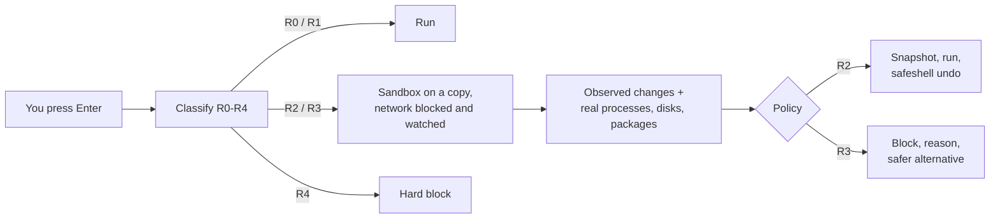

<h1 align="center">SafeShell</h1>

<p align="center"><b>A safety layer for your terminal.</b><br>
Every command is rated by how reversible it is, tried in a sandbox first, and blocked,<br>
confirmed or made undoable before it can hurt anything.</p>

<p align="center">
  <a href="https://github.com/samarthsinh2660/safeshell/actions/workflows/ci.yml"></a>
  <a href="https://github.com/samarthsinh2660/safeshell/releases"></a>
  <a href="https://codecov.io/gh/samarthsinh2660/safeshell"></a>
  <a href="LICENSE"></a>
  
  
</p>

```console
$ rm -rf ~/projects
R3 Irreversible  BLOCK (you can override)
$ rm -rf ~/projects

  R3  Recursively and permanently deletes whole folders. There is no recycle bin.

Safer options
  1) trash-put ~/projects
     moves them to the Trash so they can be restored

$ curl https://example.com/install.sh | sudo bash
R4 Catastrophic  HARD BLOCK
  R4  Downloads code and runs it immediately without you reading it. Whoever
      controls that server controls your machine.
```

## Why

A mistyped `rm`, a pasted `curl | sudo bash`, a `git reset --hard` on the wrong branch: most
terminal accidents are one keystroke from irreversible, and the shell gives no warning. SafeShell
sits between you and the shell and answers one question first: **can this be undone?**

- **Rates every command, R0 to R4,** by reversibility, not by how scary it sounds.
- **Shows the real effect.** Risky commands run in a rootless sandbox (user namespaces + OverlayFS) on a copy of your files, with the network blocked and watched. You see what would be deleted, which processes and disks it would touch, which files and commits a risky `git` command would lose, and which containers, volumes or cluster objects a `docker` or `kubectl` delete would remove, before anything happens.
- **Blocks with a reason and a safer alternative,** and still lets you say "do it anyway".
- **Undo that is verified.** Before an approved risky command runs, the files it will change are saved; `safeshell undo` puts them back and checks the result.
- **Optional AI helper.** Type plain English and get a command that is checked like any other. The AI can only make a command look riskier, never safer. Runs locally or with your own Claude, GPT or Gemini key.
- **Never in your way.** Read-only commands pass untouched, and if SafeShell itself breaks the shell hook fails open with a visible warning.

| Level | Meaning | What happens |
|---|---|---|
| R0 | Read-only | runs |
| R1 | Easily reversed | runs |
| R2 | Reversible with a snapshot | snapshot taken, runs, `safeshell undo` puts it back |
| R3 | Irreversible | blocked, with the reason and a safer alternative; you can still override |
| R4 | Catastrophic | hard block |

## Install

Linux, amd64 or arm64, bash or zsh.

**Debian / Ubuntu (amd64 or arm64):**

```bash
arch=$(dpkg --print-architecture)   # amd64 or arm64
wget https://github.com/samarthsinh2660/safeshell/releases/download/v1.1.1/safeshell_1.1.1_${arch}.deb
sudo apt install ./safeshell_1.1.1_${arch}.deb
safeshell install          # adds the hook to your shell
```

**Newest Ubuntu (series `stonking` or later), from the PPA** (updates arrive with `apt upgrade`):

```bash
sudo add-apt-repository ppa:samarthsinh/safeshell
sudo apt install safeshell
```

**Any Linux (amd64 or arm64):**

```bash
wget https://github.com/samarthsinh2660/safeshell/releases/download/v1.1.1/safeshell-v1.1.1-linux-amd64.tar.gz
tar -xzf safeshell-v1.1.1-linux-amd64.tar.gz && cd safeshell-v1.1.1-linux-amd64
bash scripts/install.sh    # add --ai to also set up the built-in AI
```

Checksums for every file are in `SHA256SUMS` on the [release page](https://github.com/samarthsinh2660/safeshell/releases/latest).

**From source** (needs Go):

```bash
git clone https://github.com/samarthsinh2660/safeshell.git && cd safeshell
make build && bash scripts/install.sh
```

Open a new terminal and every command you press Enter on is checked first. Run `safeshell doctor` to check
every part (sandbox, hook, daemon, snapshots, AI) and see what to fix, and `safeshell tour` for a one-minute walk-through in a throwaway folder. On Ubuntu 24.04+ the sandbox needs a one-time AppArmor rule; the `.deb` installs it,
otherwise run `scripts/install-apparmor.sh` (uses sudo).

> The command is `safeshell`, not `ss`: `/usr/bin/ss` already belongs to the system's `iproute2`.

## Use

Work as normal. Inside your prompt:

| Type | To |
|---|---|
| `/models` | choose the AI: download a local model, or connect Claude, GPT or Gemini with an API key, then `choose N` to pick any model your key offers |
| `safeshell models list` | print the models your active cloud provider offers (one per line, the one in use marked) |
| `/help` | guided help (also `safeshell help`) |
| `safeshell undo` | restore what the last approved command changed |
| `safeshell learn on` | learning mode: one line after each command that passes, saying what it does and the safer form (`off` to stop; see `safeshell help learn`) |
| `show the 5 largest files here` | have the AI propose a command, which is then checked like any other |
| Ctrl-X Ctrl-V | speak a request; the words appear on the line to read, edit and run as usual |

Without the hook you can use the pieces directly:

```bash
safeshell check 'rm -rf ~/projects'      # rate a command without running it
safeshell analyze 'make clean'           # sandbox run + processes, disks and safer options
safeshell explain 'find . -delete'       # plain-English explanation (needs AI)
safeshell explain --why 'rm -rf build'   # which rule and evidence set the level (no AI needed)
safeshell snapshots                      # what undo can restore
```

## How it works



Observed effects and the AI can only raise a rating, never lower it. More in
[doc/architecture.md](doc/architecture.md).

## AI (optional, off until you choose)

- **Local, default Qwen2.5-Coder 3B.** SafeShell downloads and manages a pinned, checksum-verified `llama.cpp`
  server (CUDA, Vulkan or CPU, picked for your machine) and the model. Starts on demand, stops when idle.
  Nothing is downloaded until you ask.
- **Cloud.** Claude, GPT or Gemini with your own key, stored with `0600` permissions or read from
  `ANTHROPIC_API_KEY`, `OPENAI_API_KEY`, `GEMINI_API_KEY`. Your home path is redacted before anything is sent.
- **Voice.** Speech is turned into text locally by whisper.cpp, built and managed by `safeshell voice setup`, which also installs what it needs (cmake, a C++ compiler and a recorder such as `pipewire-bin`) with `sudo apt-get` after asking; `--yes` skips the question.
  The words then go through the same path as typed English, so the usual checks apply.

`safeshell ai bench` measures the active model on 49 labelled requests: local Qwen 3B scores 100% (49 of 49),
and cloud models about 95-100% (measured on gemini-flash-lite-latest; re-run `safeshell ai bench` for the current default), with no unsafe suggestions in either.

## Measured

| | |
|---|---|
| Held-out classifier accuracy | 92.3% exactly right on 220 commands the rules were never tuned on |
| English to command | 100% (local Qwen 3B, 49 of 49) on 49 requests |
| Sandbox safety sweep | 492 labelled commands run through the real binary: no file outside the sandbox changed |
| Tests | unit, fuzz, and integration tests on a real terminal and the real kernel |

## Documentation

[Architecture](doc/architecture.md) · [Changelog](CHANGELOG.md) ·
[Presentation](doc/ppt/safeshell.pptx) ([HTML](doc/ppt/safeshell.html)) ·
[Contributing](CONTRIBUTING.md) ·
[Code of Conduct](CODE_OF_CONDUCT.md) ·
[Debian / Ubuntu packaging](doc/debian-ubuntu.md)

## Contributing

Pull requests are welcome; read [CONTRIBUTING.md](CONTRIBUTING.md) first. In short: branch from `main`,
run `make check`, open a PR. Releases are PRs from `release/vX.Y.Z`; merging one publishes the GitHub Release.
To report a security problem, use GitHub's private **Security → Report a vulnerability**.

## Licence

[MIT](LICENSE). Built by Samarth Vala (23BCP422) and Tavish Gupta (23BCP064) as a Semester 7 minor project.
