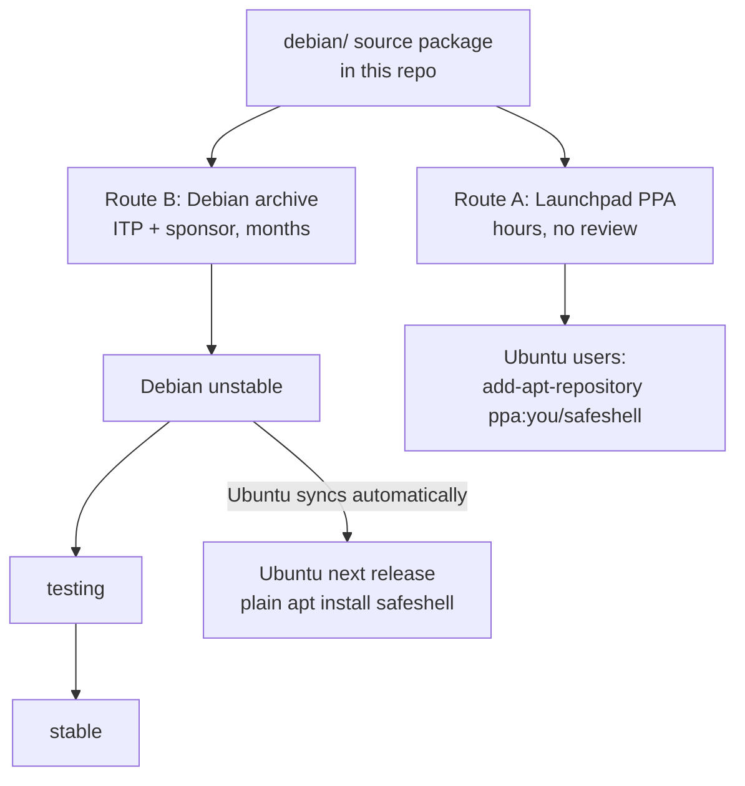
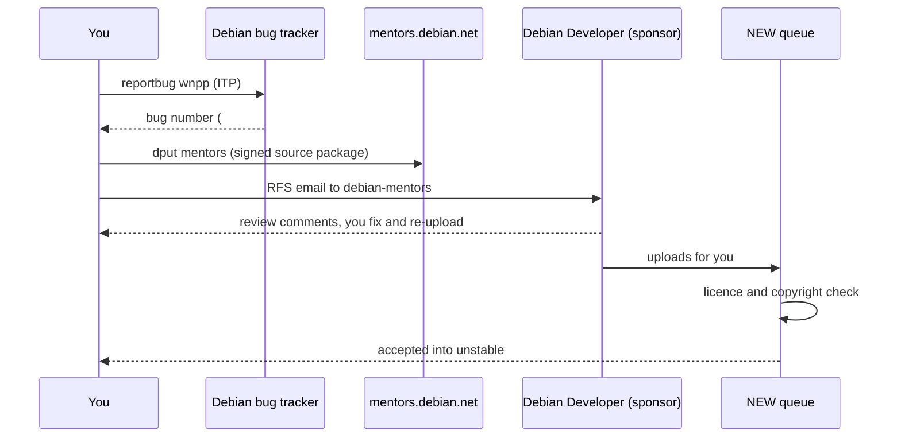

# Getting SafeShell into Debian and Ubuntu

Goal: `sudo apt install safeshell` on a stock Ubuntu or Debian machine, with no extra download.

`apt` only installs from repositories it already knows, so SafeShell has to be accepted into one.



| Route | Who can install | Time |
|---|---|---|
| A. Launchpad PPA | Ubuntu users who add the PPA first | 1 to 2 hours |
| B. Debian archive | everyone on Debian; Ubuntu gets it by sync | 2 to 6 months |

## What is already done

| Requirement | Status |
|---|---|
| Free licence | MIT ([LICENSE](../LICENSE)) |
| Full Go import path | module is `github.com/samarthsinh2660/safeshell`, `go.mod` at the repo root |
| Command name | `safeshell`. `/usr/bin/ss` belongs to `iproute2` on every Debian/Ubuntu machine, so a binary called `ss` cannot be packaged |
| Dependencies in Debian | `mvdan.cc/sh` 3.14.1, `x/sys` 0.49.0, `x/term` 0.47.0 and Go 1.26 are all in Debian unstable |
| `debian/` source package | present: `control`, `rules`, `changelog`, `copyright`, `watch`, `postinst`, `postrm`, man page, `README.Debian` |
| Builds offline in a clean Debian unstable container | yes; the 30 test packages pass inside the build |
| `lintian --pedantic` | no errors |
| No download at install time | yes; `safeshell ai setup` downloads only when the user runs it |

Re-run the check any time (needs Docker):

```bash
docker run --rm -v "$PWD":/src -w /src debian:sid bash -c '
  apt-get update -qq && apt-get install -y -qq build-essential devscripts equivs lintian fakeroot >/dev/null &&
  mk-build-deps -i -r -t "apt-get -y -qq" debian/control >/dev/null &&
  dpkg-buildpackage -us -uc -b && lintian -i --pedantic ../safeshell_*.changes'
```

## What you need to do

These steps need your accounts and identity, so only you can do them.

1. **Make a GPG key** and keep a backup. Debian and Launchpad both identify you by it.
   ```bash
   gpg --full-generate-key       # RSA 4096 or ed25519, use rajuvala80@gmail.com
   gpg --list-secret-keys --keyid-format long
   ```
2. **Create your Ubuntu One / Launchpad account** at <https://login.launchpad.net> with `rajuvala80@gmail.com`.
   On your Launchpad profile, add the key: *OpenPGP keys → Import Key*, paste the fingerprint, then decrypt the email
   Launchpad sends and follow its link.
3. **Route A (PPA).** On Launchpad choose *Create a new PPA* named `safeshell`. Then, from the repo root:
   ```bash
   sudo apt install devscripts debhelper dh-golang
   # edit debian/changelog: change unstable to your Ubuntu series, e.g. "noble", and the version to 1.1.0-1~ppa1
   debuild -S -sa
   dput ppa:<your-launchpad-id>/safeshell ../safeshell_1.1.0-1~ppa1_source.changes
   ```
   Launchpad emails you when it builds. Note: Launchpad builds without network, and Ubuntu's own Go and library
   packages are older than Debian unstable's, so the PPA build can fail on the dependency versions for older Ubuntu
   releases. Target the newest Ubuntu series first. If it fails, Route B is the way.
4. **Route B (Debian).**
   - Create a Debian account at <https://salsa.debian.org> (optional) and subscribe to `debian-mentors`.
   - The ITP is filed as #1153343 and `debian/changelog` already closes it (`Closes: #1153343`).
   - Register at <https://mentors.debian.net> and upload the signed source package:
     ```bash
     debuild -S -sa
     dput mentors ../safeshell_1.1.0-1_source.changes
     ```
   - Email `debian-mentors@lists.debian.org` with subject `RFS: safeshell/1.1.0-1 [ITP]`, the mentors link,
     and two lines on what it does. A Debian Developer reviews it, asks for changes, and uploads it for you.
   - After upload it waits in the NEW queue (days to weeks), then enters unstable.
5. **Ubuntu** copies Debian's packages into its next release automatically; nothing to submit. If you miss the
   freeze, `requestsync safeshell` files a sync request.



Useful links: [Debian New Maintainers' Guide](https://www.debian.org/doc/manuals/maint-guide/),
[Debian Go team](https://go-team.pages.debian.net/packaging.html),
[mentors FAQ](https://mentors.debian.net/intro-maintainers/).

Until one of these routes is live, friends install the `.deb` from the GitHub release.
