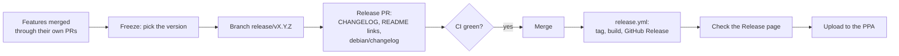

# Releasing SafeShell

This is the maintainer's guide to cutting a release, plus the plan for the next ones.
Contributors don't need it: features land through ordinary pull requests (see
[CONTRIBUTING.md](../CONTRIBUTING.md)).

## How a release works

A release is a pull request from a branch named exactly `release/vX.Y.Z` into `main`. When it
is merged, `.github/workflows/release.yml` does the following:
1. Checks the branch name and reads the version from it.
2. Runs `make check`.
3. Builds the amd64 and arm64 tarballs and `.deb` files, plus `SHA256SUMS`.
4. Creates the tag `vX.Y.Z` on the merge commit and the GitHub Release with those files attached.

The version comes from the branch name. Nothing else needs to be bumped in code.



## Picking the version

Use [semantic versioning](https://semver.org/):

| Change since the last release | Bump | Example |
|---|---|---|
| Only fixes (classifier rules, bugs, docs) | patch | 1.1.0 → 1.1.1 |
| A new command, flag or feature; JSON gains fields | minor | 1.1.0 → 1.2.0 |
| A removed command or flag, or JSON output changing shape | major | 1.x → 2.0.0 |

Until 2.0, a small JSON shape change, such as `sim.Warnings` becoming objects in 1.1.0, can go
in a minor release if the CHANGELOG says so plainly under **Changed**.

## Checklist

### Before the branch
- [ ] Every feature planned for this version is merged. Unfinished work waits for the next one.
- [ ] `main` is green in CI.
- [ ] On a machine with a working sandbox: `make check && make build && make integration`, and
      `SS_SWEEP=1 go test ./test/integration -run Sweep`.
- [ ] If the AI or prompt changed: `safeshell ai bench` with the local model and one cloud model.
      Note the scores for the CHANGELOG.
- [ ] Try the new features by hand once (for example `safeshell voice setup`, then `safeshell voice`).

### The release PR (release prep only, no features)
```bash
git switch main && git pull
git switch -c release/vX.Y.Z
```
- [ ] `CHANGELOG.md`: add a `## X.Y.Z - YYYY-MM-DD` section with **Added**, **Changed** and
      **Fixed**, linking issue numbers. Put anything that changes output or behaviour under
      **Changed**.
- [ ] `README.md`: update the download links (`v1.0.0` → `vX.Y.Z` in the `.deb` and tarball
      lines) and any numbers that changed (bench size, accuracy).
- [ ] `debian/changelog`: add a new entry with `dch -v X.Y.Z-1 -D unstable`, keeping the same
      maintainer line.
- [ ] Open the PR with the template. The title is `release: vX.Y.Z`.

### After the merge
- [ ] The Actions tab shows `release` green.
- [ ] The Release page has both tarballs, both `.deb` files and `SHA256SUMS`.
- [ ] Spot-check on a clean machine:
      `wget …/safeshell_X.Y.Z_amd64.deb && sudo apt install ./safeshell_X.Y.Z_amd64.deb && safeshell doctor`.
- [ ] PPA: from the release tag, follow Route A in [debian-ubuntu.md](debian-ubuntu.md). Use the
      version `X.Y.Z-1~ppa1` and the newest Ubuntu series, then `debuild -S -sa` and `dput`.
- [ ] Close the version's milestone on GitHub.

### If something is wrong
Don't delete or move a published tag. Fix it in a normal PR and release the next patch
version (`vX.Y.Z+1`). If the release workflow fails before publishing, fix the workflow in a
PR, then re-run the failed job.

## Release plan

Each release has a GitHub milestone with the same name. The milestone is the full list; the table
shows the main items only.

| Version | Theme | Contents |
|---|---|---|
| **v1.1.0** | Finish what the project promised | Voice requests (#13); the AI asks when a request is unclear; only the relevant sandbox notes (#12); classifier gaps and bypasses (#8, #9, #11, #17); arm64 `.deb` (#14); installer `--yes` fix (#10) |
| **v1.1.1** | Close the worst safety gaps | Classifier and hook bypasses (#36–#41, #58, #59); the partly-mirrored sandbox gap (#50); daemon socket, sandbox terminal and safe printing hardening; current cloud models and the model picker; `--help` on every subcommand (#63) and `explain --why` (#87) |
| **v1.2.0** | Learn and see more | Learning mode (#25); read-only previews for git (#26), docker and kubectl (#27) and databases (#86); `safeshell history` (#32); a fuller `doctor` and a tour (#88); `safeshell deactivate`/`activate`; secrets sent over the network (#73) and commands that run later (#72) |
| **v1.3.0** | Trust the sandbox and undo | Correct undo and snapshots (#53, #78); secrets kept out of the audit log (#74); daemon parity (#51); packaging and CI fixes (#64, #65, #67) |
| **v1.4.0** | Shared rules | Team policies for labs and servers (#28); the remaining classifier gaps (#42–#48, #90); no raw secrets sent to cloud AI (#75) |
| **v1.5.0** | Undo you can trust | Never overwrite newer work (#92); the right snapshot (#93); quotas (#94); special files and hard links (#95, #96); snapshots without the sandbox (#98) |
| **v1.6.0** | More shells, terminals and remote machines | fish shell hook (#31); guarding AI coding agents (#99); production host labels for ssh (#100); a GitHub Action and pre-commit hook (#101) |
| **v1.7.0** | AI, voice, accessibility and other languages | Choosing the voice model and language (#33); requests in Hindi and other languages (#107); plain output for screen readers (#106); a prompt-injection test set (#105) |
| **v1.8.0** | Servers and supply chain | Strict mode (#111); protected folders (#112); per-project rules (#113); system-wide install (#114); journald and metrics (#115, #116); verifiable releases (#117) |
| **v1.9.0** | More filesystems and big folders | Native btrfs (#29) and ZFS (#30) snapshots; visible loose files (#70); undo for packages and services (#119); large folders (#120) |
| **v2.0.0** | Polish for the next major release | AI-proposed safer alternatives checked in the sandbox (#124); "don't ask again here" (#89); status and doctor text fixes (#128); small AI fixes (#125, #127) |

Issues go in milestones; pull requests don't. A pull request belongs to the release whose issue it closes.

A version ships when its milestone is empty, not on a date. Smaller fixes go out as patch
releases whenever they're ready.
